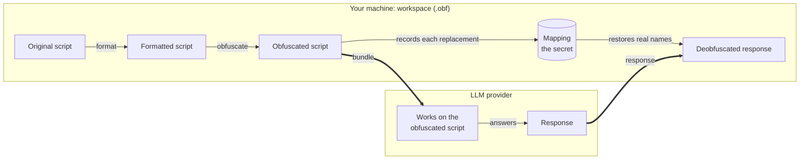

# SQL Obfuscator

Get LLM help with SQL scripts whose names and values must not leave your organisation.
The tool replaces them reversibly, you share the obfuscated script, and the answer is
translated back into your real names.

> [!WARNING]
> **Not usable yet.** Milestone 0 (foundation) is complete: the design is decided and
> recorded, and the test scripts are in place. The `sqlobf` commands exist but do nothing
> until milestone 1. This page describes how the tool is designed to work.

## What it does

```sql
-- original
SELECT c.CustomerName, o.Total
FROM SalesDB.dbo.Customers c
JOIN SalesDB.dbo.Orders o ON o.CustomerId = c.Id
WHERE c.Region = 'EMEA'

-- obfuscated
SELECT warm_seal.Gentle_Otter, tidy_mole.Calm_Lynx
FROM Quiet_Heron.dbo.Frozen_Lion warm_seal
JOIN Quiet_Heron.dbo.Brisk_Moth tidy_mole ON tidy_mole.Vivid_Crane = warm_seal.Shy_Wolf
WHERE warm_seal.Keen_Gecko = 'text_001'
```

The structure is untouched, so an LLM can still explain, review or change the script. It
just cannot learn what the script is about. When its answer comes back, `frozen_lion`
becomes `Customers` again, in SQL and in prose alike.

## How it works



Only the two thick arrows cross the boundary. The original script, the formatted script
and the mapping never leave your machine.

1. **Format.** The original script is pretty-printed, because real scripts are often hard
   to read. Nothing is renamed yet.
2. **Obfuscate.** Every name and protected value is replaced, and each replacement is
   recorded in the mapping.
3. **Bundle.** The obfuscated script is combined with your task and with instructions that
   tell the LLM the script is obfuscated and to keep its changes small. Your task text goes
   through the same replacement, so "why is the Customers join slow?" does not leak a name.
4. **Deobfuscate.** The response is translated back with the mapping and saved next to a
   diff against your formatted script. Nothing overwrites your scripts automatically.

Everything for one script, or for a set of related scripts that share fake names, lives in
a **workspace**: a folder ending in `.obf`. It holds the mapping, which is as sensitive as
your original scripts, so a workspace ignores itself in git.

## What is replaced and what stays visible

| In the script | Default | Example |
|---|---|---|
| Names: tables, columns, schemas, databases, aliases, CTEs, temp tables, variables, procedures | Replaced | `Customers` becomes `Frozen_Lion` |
| Strings | Replaced | `'EMEA'` becomes `'text_001'` |
| Numbers | **Kept** | `TOP 10` and `4711283` both stay |
| Comments | Replaced by a marker and restored afterwards | `/* c12 */` |
| Keywords, built-in functions, data types | Kept | `SELECT`, `GETDATE()`, `VARCHAR(100)` |
| Structure and layout | Kept | |

- The same name always gets the same fake name, across every script in a workspace.
- Qualified names are replaced part by part, so `Customers` and `dbo.Customers` stay
  recognisably the same table.
- A seed makes the choice of fake names repeatable for a new workspace. After that, the
  stored mapping decides, and a name never changes once it has a fake name.
- Harmless words can be added to a keep-list. Strings and values that must never appear in
  an obfuscated script go on a ban-list.

[What gets replaced and what is kept](docs/reference/what-gets-replaced.md) states the
rules exactly, including the limits.

## What you can rely on, and what you cannot

Every obfuscation runs four checks. If one fails, no obfuscated script is written, and
there is no option to override that.

1. **Round-trip:** deobfuscating the result gives back the formatted script exactly.
2. **Leak:** no name or protected value from the original is left in the result.
3. **Structure:** the result has the same kinds of tokens in the same order.
4. **Ban-list:** nothing on your ban-list appears in the result (from milestone 2).

The limits:

- **Numbers are visible by default.** If your scripts contain sensitive numbers such as
  account numbers or thresholds, you will have to switch number obfuscation on (planned
  for milestone 2; its rule is still a proposal).
- **Structure is visible on purpose.** Someone who already knows your database could
  recognise a script by its shape. The tool does not try to prevent that.
- **The task text is yours to check.** The tool cannot catch a sensitive word that appears
  in no script and is not on the ban-list, so read the bundle before you send it.

## Supported SQL

T-SQL first, including stored procedures with `GO` batches, cursors and `TRY/CATCH`. Hive
follows in milestone 2.

The engine reads the script as a stream of tokens and does not rely on a full parse. SQL
parsers stumble on procedural T-SQL, and a script the parser misreads would leak or come
back corrupted. Reading tokens means anything the tool does not recognise is replaced, so
a mistake produces too much obfuscation and never a leak.
[Decision record 0001](docs/adr/0001-token-first-engine.md) has the evidence.

One consequence: pretty-printing is best-effort. Plain queries and table definitions are
formatted; procedural code is left as written until milestone 4.

## Commands

| Command | Purpose | Arrives in |
|---|---|---|
| `sqlobf obfuscate` | Create or update a workspace from one or more scripts. | Milestone 1 |
| `sqlobf deobfuscate` | Translate any text (SQL, Markdown, HTML) back using a workspace's mapping. | Milestone 1 |
| `sqlobf format` | Pretty-print a script without obfuscating it. | Milestone 1 |
| `sqlobf map` | Show, search or export the mapping. | Milestone 1 |
| `sqlobf bundle` | Produce instructions, task and obfuscated script for an LLM. | Milestone 3 |

Five commands, on purpose. Settings are stored in the workspace the first time you use it,
so later commands need no flags.

## Roadmap

| # | Milestone | Status |
|---|---|---|
| 0 | Foundation: decisions, test scripts, word lists, CI | Done |
| 1 | Core command line for T-SQL | Next |
| 2 | Hive, ban-list, keep-list, number obfuscation, several scripts per workspace | Planned |
| 3 | The LLM loop: bundle and response handling | Planned |
| 4 | Formatting inside procedure bodies | Planned |
| 5 | Web UI (FastAPI, React and Vite) | Planned |
| 6 | Direct LLM connection, notes on tables and columns, diagrams | Planned |
| 7 | Team use: central server, multi-user, auto-update | Planned |

Details are in [docs/milestones.md](docs/milestones.md).

## Development

Requires Python 3.12 or later and [uv](https://docs.astral.sh/uv/).

```bash
uv sync
uv run pytest
uv run ruff check
uv run ruff format --check
```

## Where things are

- [CONTEXT.md](CONTEXT.md): the project's vocabulary. Use these terms in code and docs.
- [docs/adr/](docs/adr/): why the design is the way it is. Read 0001 before touching the engine.
- [docs/reference/what-gets-replaced.md](docs/reference/what-gets-replaced.md): the user-facing rules.
- [docs/milestones.md](docs/milestones.md): the plan.
- [docs/history/](docs/history/): one self-contained HTML page per finished milestone: what was done, the evidence, and what we would do differently. Open the file in a browser.
- [tests/scripts/](tests/scripts/README.md): the SQL test scripts.
